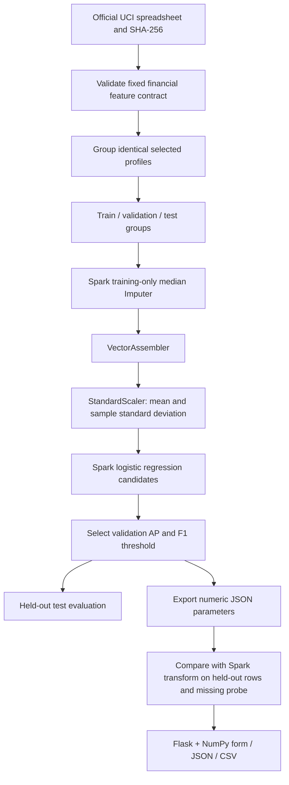
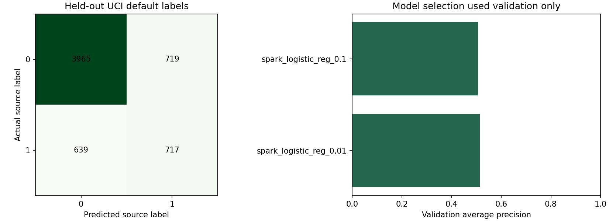
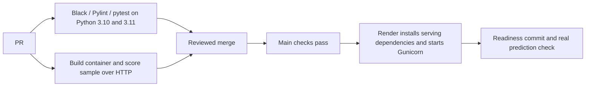

# Spark Credit Explorer

An end-to-end Flask application with **real PySpark MLlib training** and lightweight **NumPy inference from a verified JSON export**. Explore synthetic financial-history inputs, inspect source-label scores, score a CSV and understand the evaluation.

**Dataset change:** the original Home Credit notebook needs `application_train.csv`, which is absent and subject to Kaggle competition rules. The deployable application instead uses the openly licensed **UCI Default of Credit Card Clients** dataset. It does not claim Home Credit results. Original notebook/PDF remain unchanged under `Codes/`; the previous README and requirements are in `archive/`.

## Problem, scope and data

This is historical binary classification: predict the source's **next-month credit-card default label** from earlier credit limits, repayment-status codes, statement balances and payment amounts. It is an educational research demonstration, not a lending decision system or a current applicant risk estimate.

Source: Yeh, I. (2009), [Default of Credit Card Clients, UCI 350](https://doi.org/10.24432/C55S3H), **CC BY 4.0**. The source contains 30,000 Taiwan credit-card records from 2005. Amounts are source **NTD**, not INR or USD. Attribution and adaptations are recorded in [data/README.md](data/README.md).

The model uses **19 financial features**: `LIMIT_BAL`, six repayment codes (`PAY_0`, `PAY_2`–`PAY_6`), six bill amounts and six payment amounts. Month 1 is September 2005 and month 6 is April 2005. Do not rename the source's `PAY_0` to `PAY_1`. Negative bill balances are allowed; negative payment amounts are rejected. Repayment -1 is documented as paid duly; source -2/0 are retained without inventing new meanings.

ID, sex, education, marital status and age are excluded. This avoids directly using those fields, but **does not establish fairness**: retained financial variables can act as proxies. No raw customer identifiers or private user inputs are needed by the interface.

## Architecture and learning flow



**Why Spark?** Spark partitions data and executes transformations across workers. MLlib pipelines keep preprocessing and estimator stages together. This 30,000-row dataset does not require a cluster; local two-worker training demonstrates the architecture without claiming distributed speed gains. Spark adds JVM startup, memory and operational complexity compared with a small scikit-learn job.

**Why export?** The online service needs a small numerical calculation, not a Spark cluster per request. The export contains feature order, fitted medians, scaling means/deviations, coefficients and intercept. It is plain JSON, not a pickle. Serving imports neither Spark nor scikit-learn. Java is required only for offline training.

## What the algorithm actually calculates

1. **Median imputation** fills missing values using medians fitted only on training rows. This is robust to extreme values but ignores relationships between features.
2. **VectorAssembler** puts numbers in one fixed feature order. Wrong ordering changes predictions even if every value is individually valid.
3. **StandardScaler** centers and scales each assembled coordinate: `z[j] = (x[j] - mean[j]) / std[j]`. Spark uses its fitted sample standard deviation. A zero-variance coordinate contributes zero.
4. **Logistic regression** computes margin `m = intercept + sum(coef[j] * z[j])`, then score `p = 1 / (1 + exp(-m))`. The NumPy implementation uses a numerically stable sigmoid for extreme inputs.
5. Spark minimizes regularized logistic loss. The candidates use L2 regularization values **0.01** and **0.1**; stronger regularization discourages large weights. A linear boundary is fast and interpretable in feature space, but cannot directly capture complex interactions.
6. Validation **average precision** selects `spark_logistic_reg_0.01`. A validation positive-class F1 search chooses threshold **0.25**. No test labels are used for those choices.
7. The released pipeline remains fitted on training rows, so preprocessing, export and reported test results refer to the same model.

A score is not a calibrated probability of default for a current person. Lowering the threshold generally increases recall and false alarms. The UI's threshold changes the displayed decision; it does not rewrite the published test evaluation.

## Split and measured results

Identical selected numeric profiles share a group. `GroupShuffleSplit` uses seeds 42 and 43 for approximately 60/20/20 train/validation/test allocation. This reduces exact-profile leakage, but is **not temporal, geographic or institution-separated validation**. Correlated clients and historical population limits remain.

| Split | Rows | Positive source labels |
|---|---:|---:|
| Train | 17,982 | 3,957 |
| Validation | 5,978 | 1,323 |
| Test | 6,040 | 1,356 |

| Test metric | Value | Use and limitation |
|---|---:|---|
| Accuracy | 0.7752 | Overall correct fraction; majority-class accuracy is about 0.7755, so accuracy alone shows no useful gain. |
| Macro F1 | 0.6837 | Treats both classes equally, unlike prevalence-weighted averages. |
| Positive precision | 0.4993 | About half of positive predictions match the source positive label. |
| Positive recall | 0.5288 | Finds about 53% of source positives at the chosen threshold. |
| Positive F1 | 0.5136 | Balances precision and recall; threshold-dependent. |
| Average precision | 0.5140 | Ranks positives across thresholds; prevalence affects its baseline. |
| ROC AUC | 0.7234 | Ranking across positive/negative pairs; can hide poor precision with imbalance. |

Confusion matrix, rows actual and columns predicted: `[[3965, 719], [639, 717]]`. The errors and modest ranking performance do not justify real credit decisions. [models/metrics.json](models/metrics.json) contains all candidate/baseline metrics, source hash and export checks.



**Export verification:** maximum absolute score difference from Spark on held-out rows was **3.33 × 10⁻¹⁶**, with a separate missing-value probe difference of **5.55 × 10⁻¹⁷**. These verify equivalent arithmetic for this pipeline, not model accuracy or arbitrary Spark stages. Export code must change if the pipeline changes.

## Run the web app locally

Python 3.10 or 3.11 is supported. The bundled JSON model requires no dataset download or Java installation for serving.

```bash
git clone https://github.com/subhashdixit/pyspark-credit-risk.git
cd pyspark-credit-risk
python3 -m venv .venv
source .venv/bin/activate
python -m pip install -r requirements-dev.txt
python -m pip install --no-deps -e .
python -m flask --app wsgi:app run --port 8000
```

Open `http://127.0.0.1:8000`. Initial fields are a **synthetic combination of training medians**, not a customer. Change fields, submit and inspect class scores. Download the example CSV, keep all 19 headers and upload up to 500 rows within 1 MiB. Blank/null fields use the saved training imputation; missing columns, booleans, nonfinite values and unsupported ranges are rejected. Extra columns are ignored. Inputs are not written to storage by application code.

```bash
curl -s http://127.0.0.1:8000/health/ready
curl -s http://127.0.0.1:8000/api/metrics
curl -s http://127.0.0.1:8000/sample.csv -o sample.csv
curl -s -X POST http://127.0.0.1:8000/predict-csv -F file=@sample.csv -o predictions.csv
```

`POST /api/predict` accepts `{"records":[{...all 19 fields...}],"threshold":0.25}`. It returns source categories, descriptions and relative class scores. Use the CSV header/sample JSON to construct a full valid record; the ellipsis is explanatory, not executable JSON. Outputs include row numbers rather than echoing input financial values.

For a Linux serving process use `gunicorn --config gunicorn.conf.py wsgi:app`. Gunicorn handles WSGI requests; Flask's development server is only for local development. These public demo routes have no customer authentication or enterprise audit workflow.

## Reproduce Spark training

Install a supported **Java 17 runtime/JDK** from an official vendor and set `JAVA_HOME` to that installation. Use Python 3.10/3.11 consistently for the driver and Spark workers. The project pins PySpark 3.5.3. No system-wide Spark installation or cloud cluster is required.

```bash
python -m pip install -r requirements-training.txt
python scripts/download_data.py
python scripts/train.py
python scripts/plot_results.py
```

The downloader fetches the official UCI ZIP, extracts the unchanged spreadsheet into ignored `data/`, and prints its SHA-256. Training fits local Spark pipelines, checks export parity, then writes `models/portable-model.json`, `models/metrics.json` and `models/sample.json`. The model report records the source hash and Spark version. Commit those artifacts together only after reviewing results. Java/Spark are deliberately absent from production requirements.

No Kaggle credentials or acceptance of Home Credit rules is needed for this UCI version. To return to the original Home Credit task, obtain authorized data and build a separate feature/data adapter and evaluation; this UCI model is not interchangeable with Home Credit inputs.

## Code structure and quality

```text
Codes/                       preserved original Home Credit notebook/PDF
src/spark_credit/schema.py   one bounded feature contract
src/spark_credit/service.py  JSON integrity/schema checks and NumPy scoring
src/spark_credit/web.py      Flask application factory and routes
src/spark_credit/templates/  responsive server-rendered interface
scripts/download_data.py    official UCI acquisition
scripts/train.py            actual Spark training and parity verification
scripts/plot_results.py     evaluation visualization
scripts/smoke_test.py       real HTTP prediction and revision check
models/                     versioned numeric export, card and sample
tests/                      actual-model and API behavior checks
render.yaml                 free native-Python hosting definition
Dockerfile                  non-root serving runtime
.github/workflows/ci.yml    code and container release checks
```

```bash
python -m black --check src scripts tests wsgi.py gunicorn.conf.py
python -m pylint src scripts wsgi.py gunicorn.conf.py
python -m pytest -q
python scripts/smoke_test.py --url http://127.0.0.1:8000 --attempts 3
```

Pylint includes offline training imports, so install training requirements for the full lint command. Runtime tests do not start Spark. They check real exported inference, null handling, stable sigmoid/zero-variance behavior, invalid thresholds, batch limits, integrity refusal, forms, JSON, CSV and readiness. The training script independently checks Spark-transform parity before producing a releasable artifact. Black standardizes formatting; Pylint catches common code problems; tests check behavior. None establishes fairness or current population validity.

## Docker, CI/CD and Render deployment

```bash
docker build -t pyspark-credit-risk:local .
docker run --rm --read-only --tmpfs /tmp -p 8000:8000 pyspark-credit-risk:local
```

Docker packages a consistent serving environment and the exact numeric artifact. A non-root user and read-only filesystem limit incidental writes; they do not make this an audited production system. Docker adds build/image maintenance, while the native Render service is simpler for this small app. Both serve the same application.



**CI** is repeated automated validation of changes. **CD** publishes a passing revision. The workflow uses pinned action commits, bounded jobs and test-result artifacts. It does not retrain on every request or pretend that CI unit tests are a new model evaluation. Render's `checksPass` deployment trigger waits for checks on the merged commit.

Connect the repository in Render, create a Blueprint from `render.yaml`, confirm **Free**, and deploy. The build installs production requirements and the package, then Gunicorn binds to the provider `PORT`. `/health/ready` exposes the deployed Git revision. Verify that revision and run the smoke test against the public URL. **Hosting** supplies the machine/public HTTPS endpoint; **deployment** starts a particular code/model revision there. [Render free limits](https://render.com/docs/free) include idle spin-down, shared monthly runtime and ephemeral storage; this is a portfolio demonstration rather than an always-on promise.

**Versioning and rollback:** Git versions code, numeric model, source metadata and configuration together. Tag known-good releases. Revert a bad change through a PR and let the checks/deploy flow publish the restored version, or select an earlier successful provider deployment and verify it. Restore compatible dependencies as well as weights. A hash catches accidental mismatches; it is not independent proof against malicious edits to both model and manifest.

**Retraining** requires an authorized source, repeatable split/preprocessing, evaluation review and export-parity checks. It is separate from redeploying unchanged weights. Future improvements include untouched time-separated data, nonlinear comparisons, calibration, subgroup error analysis, source-drift monitoring and human governance. They are not claimed to be completed here.

References: [Spark ML pipelines](https://spark.apache.org/docs/latest/ml-pipeline.html), [scikit-learn evaluation definitions](https://scikit-learn.org/stable/modules/model_evaluation.html), [UCI source](https://archive.ics.uci.edu/dataset/350/default+of+credit+card+clients), [Render Flask deployment](https://render.com/docs/deploy-flask).
